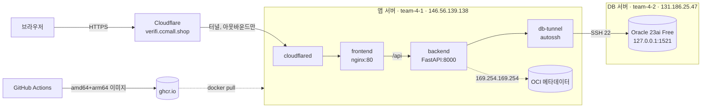

# OCI 배포 가이드 (서울 리전, 콘솔 권한 없이)

> 목표: `https://verifi.ccmall.shop` 으로 접속하면 OCI 인스턴스에서 돌아가는 Verifi가 뜨고, 화면 상단 배지와 `시스템` 메뉴에서 **어느 OCI 인스턴스·리전**이 응답했는지 보인다.

## 0. 전체 구조



**콘솔 권한이 없어서 이렇게 설계했어요.**

| 막힌 것 | 대신 쓰는 것 |
|---|---|
| 보안 목록에서 80/443 열기 | Cloudflare 터널 (서버가 밖으로 나가는 연결만 사용) |
| 보안 목록에서 1521 열기 | SSH(22번, 이미 열려 있음) 터널로 DB 포트 전달 |
| OCIR 인증 토큰 발급 | GitHub Container Registry (GHCR) |
| 콘솔에서 인스턴스 정보 보기 | 인스턴스 메타데이터 서비스 `169.254.169.254` |
| Autonomous DB 생성 | Oracle Database 23ai Free 컨테이너 |

## 1. 사전 확인 (각 서버에서 1분)

```bash
ssh opc@146.56.139.138 -i team-4-1.key      # 앱 서버
uname -m          # x86_64 또는 aarch64 — 어느 쪽이든 이미지가 둘 다 있어서 상관없음
free -h           # DB 서버는 여유 메모리 2GB 이상 필요
df -h /           # Oracle 이미지+데이터 약 6GB
curl -s -H "Authorization: Bearer Oracle" http://169.254.169.254/opc/v2/instance/ | head -c 300
                  # displayName, canonicalRegionName 이 보이면 시연 배지가 동작함
```

## 2. git · Docker 설치 (두 서버 모두)

Oracle Linux에는 git이 기본으로 없어요. 먼저 git부터:

```bash
sudo dnf install -y git
git --version
```

그다음 Docker:

```bash
curl -fsSL https://raw.githubusercontent.com/hacksungboo/verify_infra/main/scripts/install-docker.sh | bash
exit   # 다시 접속해야 docker 그룹이 반영됨
```

> 저장소가 private이면 `curl` 대신 `git clone` 후 `bash scripts/install-docker.sh`.

## 3. DB 서버 (team-4-2)

```bash
ssh opc@131.186.25.47 -i team-4-2.key
git clone https://github.com/hacksungboo/verify_infra.git && cd verify_infra/db-server
cp .env.example .env && vi .env      # ORACLE_PASSWORD, APP_USER_PASSWORD (영문·숫자만)
docker compose up -d
docker compose logs -f oracle        # "DATABASE IS READY TO USE!" 확인 후 Ctrl+C
```

접속 테스트:

```bash
docker exec -i verifi-oracle sqlplus -s verifi/<APP_USER_PASSWORD>@FREEPDB1 <<< "select banner_full from v\$version;"
```

> 첫 기동만 2~5분 걸려요. 이후 재시작은 수십 초.

## 4. 이미지 빌드 → GHCR (내 PC에서 할 일 없음)

1. `verify_app` 저장소 `main`에 push하면 **Actions → build-images** 가 자동 실행돼요.
2. 끝나면 저장소 오른쪽 **Packages** 에 `verify-frontend`, `verify-backend` 가 생겨요.
3. **패키지를 public으로 바꾸면** 서버에서 로그인 없이 pull할 수 있어요.
   패키지 → Package settings → Change visibility → Public
4. private으로 둘 거면 앱 서버에서 한 번 로그인:
   ```bash
   # GitHub → Settings → Developer settings → Personal access tokens (classic) → read:packages
   echo <PAT> | docker login ghcr.io -u hacksungboo --password-stdin
   ```

수동으로 빌드하고 싶을 때(급할 때) — 앱 서버에서 직접:

```bash
git clone https://github.com/hacksungboo/verify_app.git && cd verify_app
docker build -t ghcr.io/hacksungboo/verify-backend:latest backend
docker build -t ghcr.io/hacksungboo/verify-frontend:latest frontend
# 이후 6단계에서 docker compose up -d 만 하면 로컬 이미지를 그대로 씀 (pull 생략)
```

## 5. Cloudflare 터널 만들기 (브라우저, 5분)

[cloudflare-tunnel.md](./cloudflare-tunnel.md) 를 따라 터널을 만들고 **토큰(eyJ…)** 을 복사해 두세요.
퍼블릭 호스트네임은 `verifi.ccmall.shop` → `http://frontend:80`.

## 6. 앱 서버 (team-4-1)

```bash
ssh opc@146.56.139.138 -i team-4-1.key
git clone https://github.com/hacksungboo/verify_infra.git && cd verify_infra/app-server
cp .env.example .env && vi .env
#   DB_PASSWORD             = DB 서버의 APP_USER_PASSWORD
#   JWT_SECRET              = $(openssl rand -hex 32)
#   CLOUDFLARE_TUNNEL_TOKEN = 5단계 토큰
#   DB_SSH_HOST             = 131.186.25.47 (같은 VCN이면 DB 서버 사설 IP)
```

DB 서버 접속 키를 앱 서버로 복사 (내 PC에서):

```bash
scp -i team-4-1.key team-4-2.key opc@146.56.139.138:~/verify_infra/app-server/keys/db.key
```

실행:

```bash
cd ~/verify_infra && ./scripts/deploy.sh
./scripts/check.sh      # 1~5번이 모두 ✓ 이면 끝
```

브라우저에서 `https://verifi.ccmall.shop` → 테스트 계정 `demo@hanbit.co.kr / verifi2026` (로그인 화면에 미리 입력됨).

## 7. 업데이트 배포

```bash
# 코드 push → Actions 끝난 뒤, 앱 서버에서
cd ~/verify_infra && git pull && ./scripts/deploy.sh          # latest
./scripts/deploy.sh 3f2a9c1                                     # 특정 커밋으로 고정/롤백
```

**토 09:00 기능 동결 이후에는 `IMAGE_TAG`를 커밋 태그로 고정**하세요. 시연 직전에 latest가 바뀌는 사고를 막아요.

## 8. 시연 때 보여줄 것 — "이게 OCI에서 돌고 있다"

| 어디 | 무엇이 보이나 |
|---|---|
| 모든 화면 상단 배지 | `● OCI ap-seoul-1 · team-4-1` (응답한 인스턴스) |
| 시스템 메뉴 | 인스턴스 이름, 리전·AD·FD, Shape·OCPU·메모리, 인스턴스 OCID, 사설 IP, 요청 경로 |
| 시스템 메뉴 DB 카드 | `Oracle Database 23ai Free Release 23.x`, PDB, VECTOR 컬럼 준비 여부 |
| 터미널 (보조) | `curl -H "Authorization: Bearer Oracle" http://169.254.169.254/opc/v2/instance/ \| jq .displayName` |

배지 값은 서버가 직접 OCI 메타데이터 서비스에서 읽으므로 꾸밀 수 없는 값이에요. 심사위원이 의심하면 OCID를 복사해 보여주면 됩니다.

## 9. 문제 해결

| 증상 | 확인 |
|---|---|
| 배지가 `로컬 실행` | 컨테이너에서 IMDS 접근 실패. `docker compose exec backend python -c "import urllib.request as u;print(u.urlopen(u.Request('http://169.254.169.254/opc/v2/instance/',headers={'Authorization':'Bearer Oracle'}),timeout=2).read()[:80])"` |
| backend 가 계속 재시작 | `docker compose logs backend` → `DB 대기 중` 이면 터널/DB 문제 |
| db-tunnel 오류 `Permission denied (publickey)` | keys/db.key 가 DB 서버 키인지, `DB_SSH_HOST` 가 맞는지 |
| db-tunnel 오류 `connect failed` | DB 서버에서 `docker compose ps` 로 oracle 이 healthy 인지 |
| `ORA-01017` | DB_PASSWORD 와 APP_USER_PASSWORD 불일치 |
| `ORA-12514` | 서비스명 `FREEPDB1` 확인, DB가 아직 기동 중 |
| 공개 주소 502 | 터널 퍼블릭 호스트네임의 서비스가 `http://frontend:80` 인지 |
| 공개 주소 1033 | cloudflared 컨테이너가 안 떠 있음 → 토큰 확인 |
| `exec format error` | 멀티아키 빌드 전 이미지. Actions 다시 실행 |
| 실시간 진행률이 안 움직임 | 프론트가 자동으로 폴링으로 전환함. nginx.conf 의 stream location 확인 |
| Docker Hub `toomanyrequests` | 잠시 후 재시도, 또는 `docker login` |
