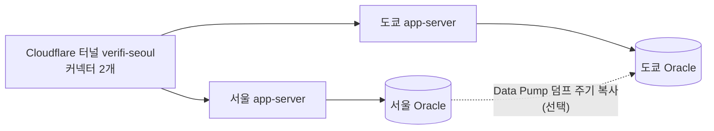

# 도쿄 리전 예비 환경 계획 (핵심 기능 완성 후)

> 지금은 계획만. 서울에서 핵심 기능이 안정되면 진행해요.

## 목표

서울 인스턴스가 죽어도 `https://verifi.ccmall.shop` 이 도쿄(ap-tokyo-1)에서 계속 응답하고, 화면 배지로 **리전이 바뀐 것**을 시연에서 보여준다.

## 구성안 (콘솔 권한 없는 상황 기준)

| 단계 | 할 일 | 비고 |
|---|---|---|
| 1 | 도쿄 인스턴스 확보 | 콘솔 권한 있는 팀원/운영진에게 요청. 1대면 app+db 같이 |
| 2 | 같은 compose 로 기동 | `DB_HOST=` 도쿄 DB, `COMPOSE_PROFILES` 에서 tunnel 제거 가능 |
| 3 | **같은 Cloudflare 터널 토큰** 사용 | 하나의 터널에 커넥터 2개 → 자동 장애 조치 |
| 4 | 데이터 | 시연용이면 각자 시드 데이터로 충분. 필요하면 Data Pump(`expdp`) 덤프를 scp |
| 5 | 장애 시연 | 서울에서 `docker compose stop cloudflared` → 새로고침 → 배지가 `ap-tokyo-1` |

## 시연 효과를 위한 앱 쪽 준비 (이미 되어 있음)

- 배지/시스템 화면이 리전·인스턴스를 메타데이터에서 실시간으로 읽음 → 별도 수정 불필요
- 헬스체크 `/api/health`, `/healthz`

## 하면 좋은 추가 작업 (시간 남을 때)

- Cloudflare **Load Balancer**(유료)로 리전별 가중치·헬스체크 → 터널 커넥터 방식보다 전환 제어가 정확
- 리전별 `DB_SERVER_LABEL` 을 다르게 넣어 DB도 어디 붙었는지 보이게
- 장애 전환 시간 측정(초) → 발표 자료의 수치로 활용
